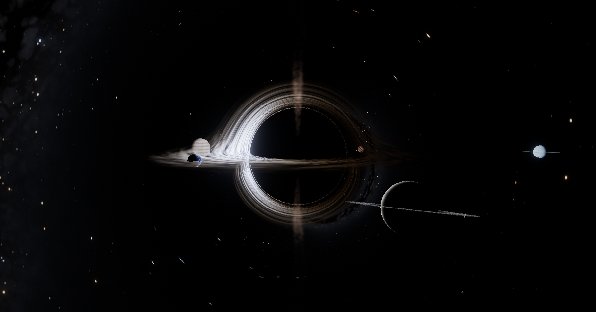

# Stellar Death — Relativistic Simulation

A real-time WebGL film of a massive star's entire death: main sequence → red supergiant → core-collapse supernova → neutron star → **ray-traced Kerr black hole** → relativistic jets → tidal disruption of its planets → 10⁷⁰ years of Hawking evaporation → the final burst → the dark era.

**Live:** https://seshkalyan-sys.github.io/stellar-death-sim/



Everything is in one self-contained `index.html` (Three.js r128 from cdnjs, custom GLSL, no build step).

---

## What makes it look real

| Element | How it is rendered |
|---|---|
| **Black hole** | Full-screen ray tracer. Every pixel integrates a null geodesic of the Schwarzschild metric (`d²x/dλ² = −3Mh²x/r⁵`, leapfrog with step ∝ r) plus a Lense–Thirring frame-dragging term for spin a/M = 0.7. You see the shadow, the photon ring, the far side of the disk lensed over the top and under the bottom, and stars stretched into Einstein arcs. |
| **Accretion disk** | Geometrically thin Novikov–Thorne disk from the Kerr ISCO (Bardeen–Press–Teukolsky, 3.393 M for a = 0.7). Each hit uses the exact redshift for circular equatorial orbits, `g = 1/[uᵗ(1 − Ωλ)]`, which includes Doppler, gravitational and transverse shifts. Because a blackbody stays a blackbody under `I_ν ∝ g³`, the observed colour is the Planck spectrum at `g·T`, so the approaching side is bluer and brighter and the receding side redder and dimmer. MRI-like turbulence is advected with Keplerian shear. |
| **Colour** | All thermal colours (stars, photosphere, disk, Hawking glow, starfield) come from the Planck function integrated against the CIE 1931 colour-matching functions (Wyman–Sloan–Shirley fit) → linear sRGB. Nothing is hand-picked. |
| **Photosphere** | Worley-cell granulation and an Eddington grey-atmosphere limb, `T(μ) = T_eff[¾(μ + ⅔)]^¼`, which gives limb darkening *and* limb reddening for free. The O star has a radiative envelope (low contrast); the red supergiant has a handful of giant convection cells. |
| **Supernova** | The iron core collapses invisibly. Shock breakout produces a UV flash, then a fireball photosphere expands and cools from ~10⁵ K toward the 5,600 K recombination plateau and becomes optically thin, revealing a remnant of Rayleigh–Taylor filaments glowing in Hα, [O III] and [S II]. |
| **Sky** | 42,000 stars with a realistic spectral-class mix and luminosity function, plus a procedural Milky Way with bulge, dust lanes and HII regions, baked into an HDR cube map. Stars do not twinkle in vacuum. |
| **Camera** | HDR (half-float) pipeline → constant optical PSF (multi-scale bloom) → eye-adaptation exposure → ACES filmic tone mapping → sRGB, with dithering. Flashes are glare in the optics, not exposure hacks. |
| **Jets** | Spine/sheath synchrotron jets with relativistic beaming `D^(2+α)`, `D = [Γ(1 − β cos θ)]⁻¹`. The jet pointing at you is boosted, and the counter-jet fades. |
| **Planets** | Lit by whatever is at the centre (star, fireball, disk). Mercury is engulfed by the supergiant. In the accretion phase, planets inspiral with `r ∝ (t_c − t)^¼`, are spaghettified inside their Roche limit and feed a tidal stream into the disk. |
| **Hawking evaporation** | Mass falls logarithmically from 10 M☉ to 10⁻¹⁹ M☉ while `T_H = ħc³/8πGMk_B` (with the Kerr factor while spin decays) climbs from nanokelvin to 10¹² K. The stars burn out first; the hole then glows red → white → blue as a shrinking ember before the final burst. |

### Honest approximations

- **Light transport:** Schwarzschild geodesics plus first-order frame dragging, not a full Kerr Hamiltonian integration. The disk kinematics (ISCO, Ω, uᵗ) are exact Kerr.
- **Disk colours:** the real inner disk is ~10⁷ K (X-ray). The visible-light rendering scales the temperature profile down to 7,200 K so the gradient lands in the visible band. The HUD shows the true value.
- **Scale:** orbits are compressed and not to scale. Planets would really be unbound by the supernova's mass loss; they are kept bound for the story.
- **Lensing of nearby objects:** solid bodies behind the hole are occluded by the shadow and the disk but are not re-imaged. The sky and the disk are fully lensed.

---

## Controls

| Input | Action |
|---|---|
| Drag / one-finger swipe | Orbit the camera |
| Wheel / pinch | Zoom |
| `Space` | Play / pause |
| `←` `→` or `0`–`9` | Jump between phases (or click the timeline) |
| `R` | Restart |
| `L` | Toggle gravitational lensing (compare with straight-line rays) |
| `B` | Toggle optical bloom |
| `G` / `O` / `P` | Spacetime embedding grid / orbit paths / photon paths (diagram layers, off by default) |

Playback speed is 0.5× to 4×. The simulation loops after the dark era. Resolution adapts automatically to keep the frame rate up.

## Running locally

```bash
python -m http.server 8000   # then open http://localhost:8000
```

Requires WebGL. Half-float render targets are used when available (`EXT_color_buffer_float`), with an LDR fallback otherwise.

## Credits

Built iteratively in conversation with Claude (Anthropic). References: Bardeen, Press & Teukolsky (1972); Novikov & Thorne (1973); Page (1976); Luminet (1979); James et al., *Gravitational lensing by spinning black holes in astrophysics, and in the movie Interstellar* (2015); Beloborodov (2002); Wyman, Sloan & Shirley (2013).

MIT License.
